<div align="center">

# 🛍️ Customer Segmentation using Clustering

### Five clustering algorithms · seven outlier detectors · one marketing strategy per customer segment

[](https://colab.research.google.com/github/ShreeyaTapaswi/Customer-Segmentation-Clustering/blob/main/Customer_Segmentation_using_clustering.ipynb)
[](LICENSE)


[**Run it in Colab**](https://colab.research.google.com/github/ShreeyaTapaswi/Customer-Segmentation-Clustering/blob/main/Customer_Segmentation_using_clustering.ipynb) · [**Watch the video**](docs/demo.mp4) · [**Read the report**](Clustering_Report.docx) · [**Notebook**](Customer_Segmentation_using_clustering.ipynb)

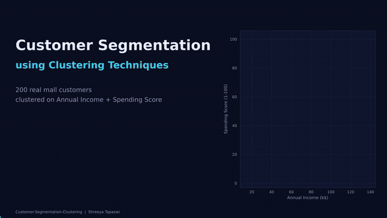

<sub>47-second walkthrough of the real pipeline: elbow method → K-Means iterating → 5 algorithms → outlier voting → final segments</sub>

</div>

---

## 📌 Overview

A shopping mall wants to understand its customers. Using each customer's **Annual Income** and **Spending Score**, this project groups **200 real customers** into meaningful segments with different clustering algorithms, evaluates how trustworthy the groups are, detects abnormal customers, and recommends a **marketing strategy for each segment**.

> 🎓 DWML (Data Warehousing & Machine Learning) mini project · Pune Institute of Computer Technology (PICT), TY Computer Engineering

## 🏆 Key results

| | |
|---|---|
| 🎯 **Best K** | **5** (elbow bends at K = 5, silhouette peaks at 0.555, dendrogram agrees) |
| 📈 **Clustering tendency** | Hopkins statistic **0.693**: genuine (moderate) cluster structure |
| 🤝 **Methods agree** | K-Means, K-Medoids and Ward agree with ARI **0.93 – 0.96**; DBSCAN and OPTICS agree with each other at **0.99** |
| 🧱 **Most stable method** | K-Means: mean ARI **0.984** over 20 random 80 % subsamples |
| 🚨 **Outliers** | **6** consensus outliers (≥ 3 of 7 detectors), all in the top income range (120–137k) |
| ✨ **After outlier removal** | Silhouette **0.555 → 0.569**, Davies-Bouldin **0.572 → 0.557**, Calinski-Harabasz **248.6 → 287.0** |
| 👥 **Final segments** | 5 interpretable groups, each with its own strategy |

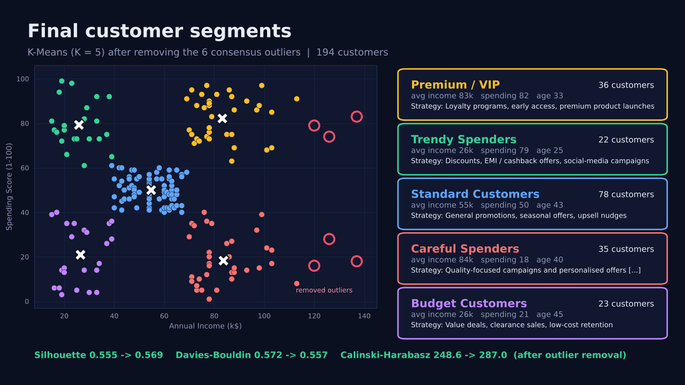

## 👥 The five customer segments

| Segment | Customers | Avg income | Avg spending | Avg age | Female | Recommended strategy |
|---|:---:|:---:|:---:|:---:|:---:|---|
| 👑 **Premium / VIP** | 36 | 83.1k | 82.4 | 32.7 | 55.6 % | Loyalty programs, early access, premium product launches |
| 🔥 **Trendy Spenders** | 22 | 25.7k | 79.4 | 25.3 | 59.1 % | Discounts, EMI / cashback offers, social-media campaigns |
| 🧑‍🤝‍🧑 **Standard Customers** | 78 | 54.6k | 50.0 | 43.1 | 59.0 % | General promotions, seasonal offers, upsell nudges |
| 🧐 **Careful Spenders** | 35 | 83.5k | 18.5 | 40.3 | 45.7 % | Quality-focused campaigns and personalised offers to raise engagement |
| 💸 **Budget Customers** | 23 | 26.3k | 20.9 | 45.2 | 60.9 % | Value deals, clearance sales, low-cost retention |

Age and gender were **not** used for clustering; they are used only to *describe* the segments.

<p align="center">
  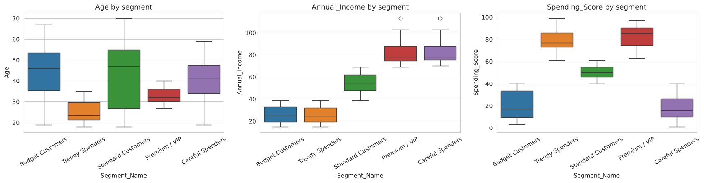<br/>
  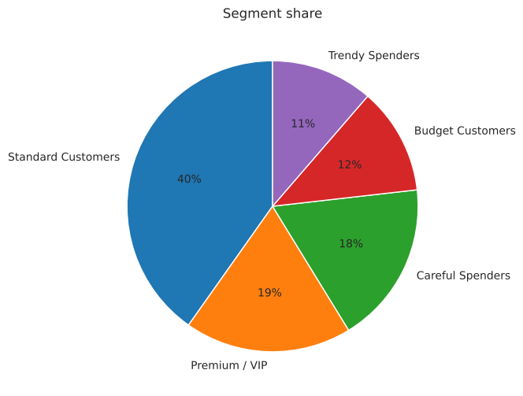
</p>

## 🧭 Pipeline

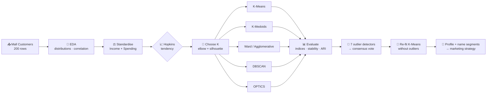

## 🧪 What is covered

| Topic | What is done in the notebook |
|---|---|
| **Partitioning** | K-Means (k-means++), K-Medoids implemented **from scratch** (alternating PAM-style) |
| **Hierarchical** | Agglomerative clustering, 4 linkages compared (single / complete / average / Ward), dendrogram, cophenetic correlation |
| **Density-based** | DBSCAN (k-distance graph + grid search for ε, MinPts), OPTICS (reachability plot) |
| **Evaluation** | Hopkins tendency, Silhouette, Calinski-Harabasz, Davies-Bouldin, subsample stability, Adjusted Rand Index between methods |
| **Outlier detection** | Z-score, IQR, Mahalanobis, K-Means centroid distance, DBSCAN noise, LOF, Isolation Forest + voting |
| **Business value** | Segment profiling, naming rules, strategy per segment, `predict_segment(income, spending)` helper |

## 📸 Results gallery

### 🔎 Exploring the data
| | |
|:---:|:---:|
| 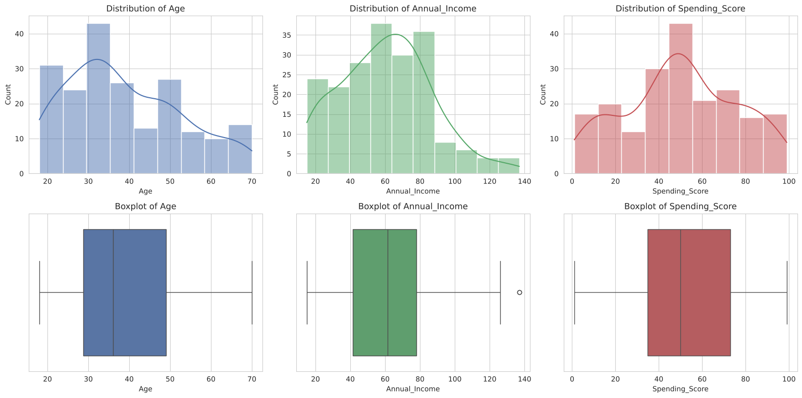 | 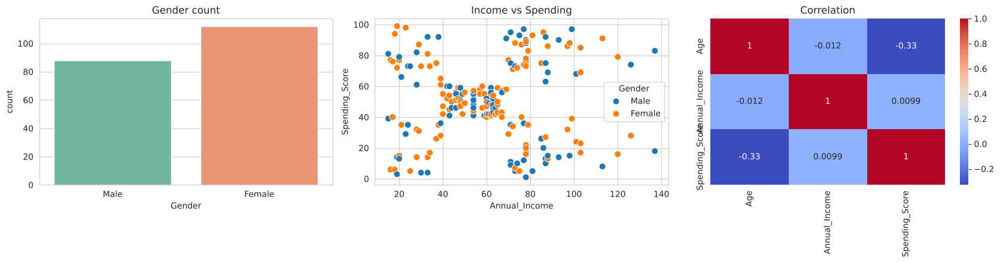 |
| Age, income and spending distributions | Gender split, income vs spending, correlation (income and spending are almost uncorrelated: 0.01) |

### 🎯 Choosing K and partitioning methods
| | |
|:---:|:---:|
| 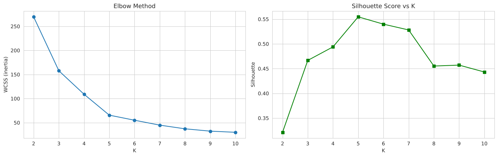 | 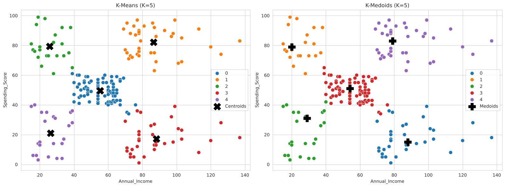 |
| Elbow and silhouette both point to **K = 5** | K-Means (centroids) vs K-Medoids (real customers as centres) |

### 🌳 Hierarchical clustering
| | |
|:---:|:---:|
| 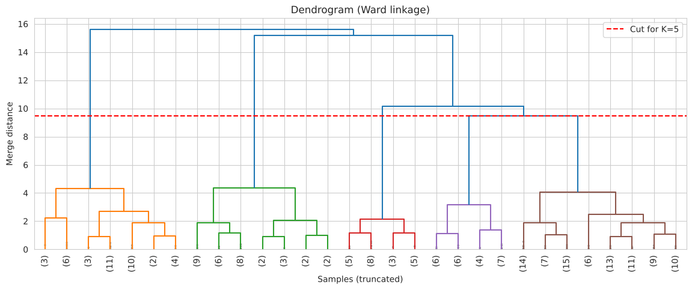 | 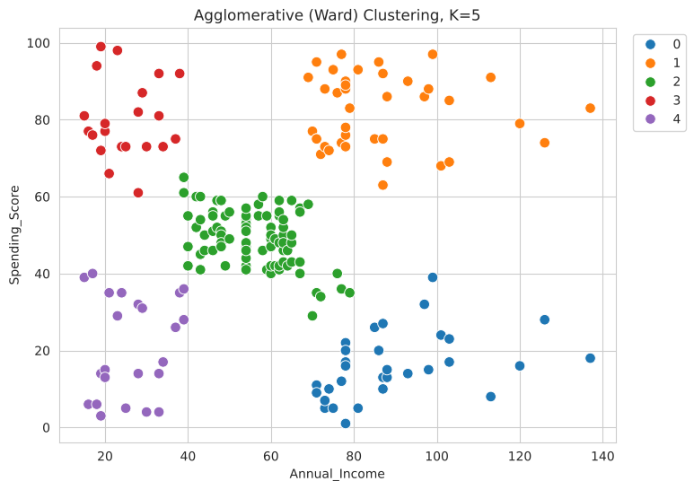 |
| Ward dendrogram cut at K = 5 | Agglomerative (Ward) result |

**Linkage comparison (K = 5)**

| Linkage | Cophenetic corr. | Silhouette | Cluster sizes |
|---|:---:|:---:|---|
| Single | 0.722 | 0.276 | 195, 2, 1, 1, 1 *(chaining effect)* |
| Complete | 0.667 | 0.553 | 79, 39, 38, 23, 21 |
| Average | 0.722 | 0.479 | 102, 38, 36, 21, 3 |
| **Ward** ✅ | 0.721 | **0.554** | 85, 39, 32, 23, 21 |

### 🌌 Density-based clustering
| | | |
|:---:|:---:|:---:|
| 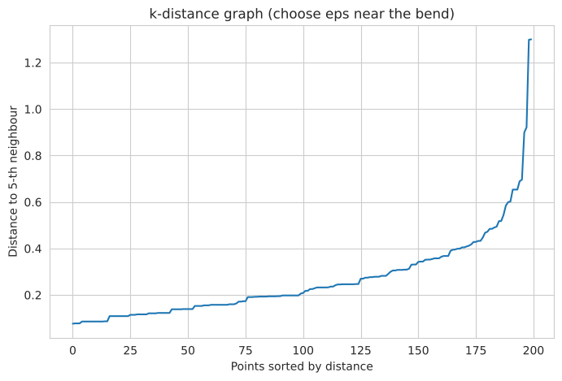 | 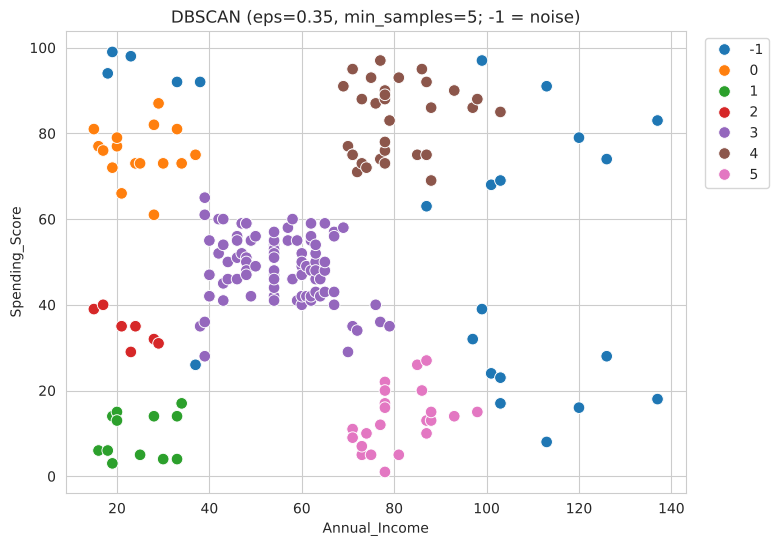 | 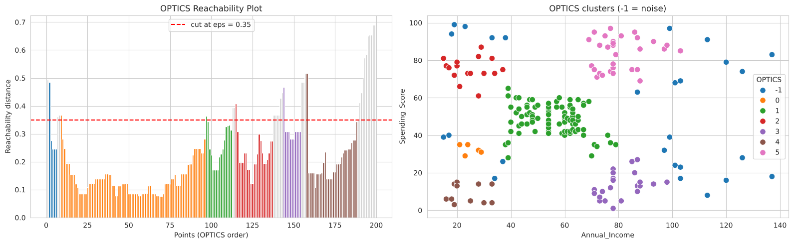 |
| k-distance graph (picks ε ≈ 0.35) | DBSCAN: 6 clusters + 23 noise | OPTICS: reachability plot, 6 clusters + 26 noise |

### 📊 Evaluating the clusterings

| Method | Clusters | Noise pts | Silhouette ↑ | Calinski-Harabasz ↑ | Davies-Bouldin ↓ | Stability (ARI) |
|---|:---:|:---:|:---:|:---:|:---:|:---:|
| K-Means | 5 | 0 | 0.555 | 248.6 | 0.572 | **0.984** |
| K-Medoids | 5 | 0 | 0.547 | 244.1 | 0.587 | 0.736 |
| Ward | 5 | 0 | 0.554 | 244.4 | 0.578 | 0.936 |
| DBSCAN | 6 | 23 | 0.558 | 245.4 | 0.511 | 0.897 |
| OPTICS | 6 | 26 | 0.552 | 237.7 | 0.490 | n/a |

> ⚠️ DBSCAN and OPTICS drop their noise points before scoring, which flatters their internal indices, so compare them with care.

| | | |
|:---:|:---:|:---:|
| 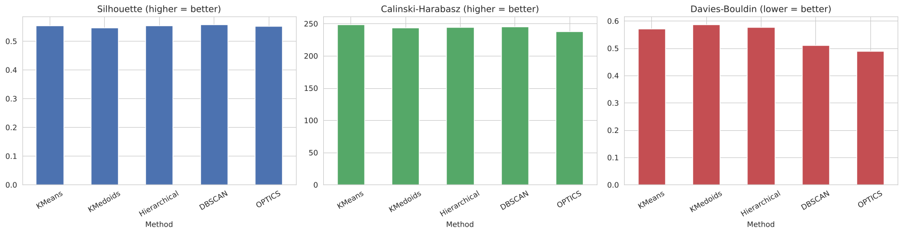 | 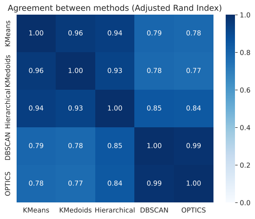 | 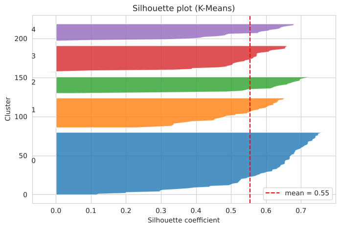 |
| Internal validity indices | Agreement between methods (ARI) | Silhouette plot (K-Means) |

### 🚨 Outlier detection

Real customers carry no "outlier" label, so seven detectors from four families were compared and combined by **voting** (≥ 3 votes = consensus outlier).

| Detector | Family | Flagged |
|---|---|:---:|
| Z-score (\|z\| > 3) | Statistical | 0 |
| IQR rule | Statistical | 2 |
| Mahalanobis (χ² cut-off) | Statistical | 2 |
| Distance to K-Means centroid | Distance-based | 6 |
| DBSCAN noise | Density-based | 23 |
| Local Outlier Factor | Density-based | 10 |
| Isolation Forest | Isolation-based | 10 |

**Consensus outliers (6):** customers **199, 200** (6 votes), **196, 197, 198** (4 votes) and **195** (3 votes), all with annual income of 120–137k. They are real, high-value customers rather than data errors, so those with high spending are natural VIP candidates.

| | |
|:---:|:---:|
| 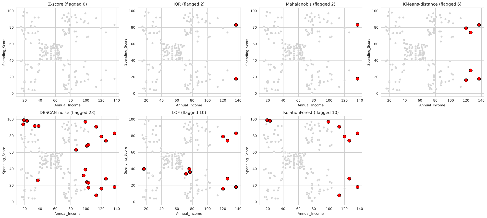 | 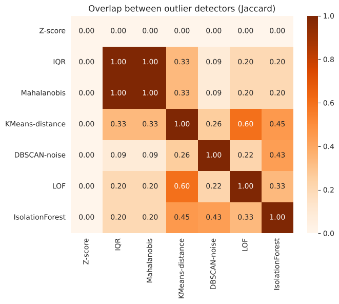 |
| Customers flagged by each detector | Jaccard overlap between detectors |

## 🚀 Run it

### Option 1: Google Colab (no setup)
Click **[Open in Colab](https://colab.research.google.com/github/ShreeyaTapaswi/Customer-Segmentation-Clustering/blob/main/Customer_Segmentation_using_clustering.ipynb)** and choose *Runtime → Run all*. The dataset downloads automatically.

### Option 2: Locally
```bash
git clone https://github.com/ShreeyaTapaswi/Customer-Segmentation-Clustering.git
cd Customer-Segmentation-Clustering

python -m venv venv
source venv/bin/activate          # Windows: venv\Scripts\activate
pip install -r requirements.txt

jupyter notebook Customer_Segmentation_using_clustering.ipynb
```

The notebook downloads the dataset from a public mirror and falls back to a **built-in copy** if you are offline. Running it writes `customer_segments.csv` with every customer's segment.

### Try the model on a new customer
```python
predict_segment(85, 80)   # -> ('Premium / VIP', 'Loyalty programs, early access, premium product launches')
predict_segment(20, 15)   # -> ('Budget Customers', 'Value deals, clearance sales, low-cost retention')
```

## 📁 Repository structure

```
Customer-Segmentation-Clustering/
├── Customer_Segmentation_using_clustering.ipynb   # full analysis (50 cells)
├── Clustering_Report.docx                         # detailed project report
├── docs/
│   ├── demo.mp4 / demo.gif                        # results walkthrough
│   ├── hero.png                                   # final segments summary
│   └── figures/                                   # 17 result figures
├── requirements.txt
├── LICENSE
└── README.md
```

## 📚 Dataset

**Mall Customer Segmentation Data** (Kaggle, 200 customers): `CustomerID`, `Gender`, `Age`, `Annual Income (k$)`, `Spending Score (1-100)`. No missing values, no duplicates. The *Spending Score* is an index assigned by the mall, not raw purchase data.
Source: [Kaggle: Customer Segmentation Tutorial in Python](https://www.kaggle.com/vjchoudhary7/customer-segmentation-tutorial-in-python).

## ⚠️ Limitations & future work

- Only 200 customers and two clustering features.
- There are no true labels, so validity rests on internal indices, stability and method agreement.
- K-Medoids is a simplified PAM (alternating version, not the full swap-based algorithm).
- **Next steps:** add age and purchase-history features, try Gaussian Mixture Models and BIRCH, implement full PAM, validate segments with real campaign response, and deploy the model as a **Streamlit dashboard**.

## 📄 License

Released under the [MIT License](LICENSE).

## 👩‍💻 Author

**Shreeya Tapaswi** · PICT, TY Computer Engineering
[](https://github.com/ShreeyaTapaswi)

<div align="center">⭐ If you found this useful, please star the repo!</div>
